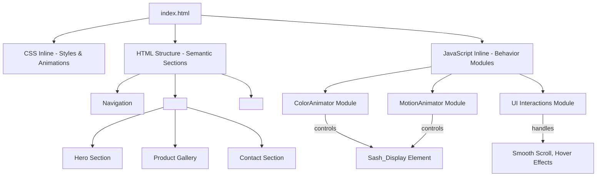
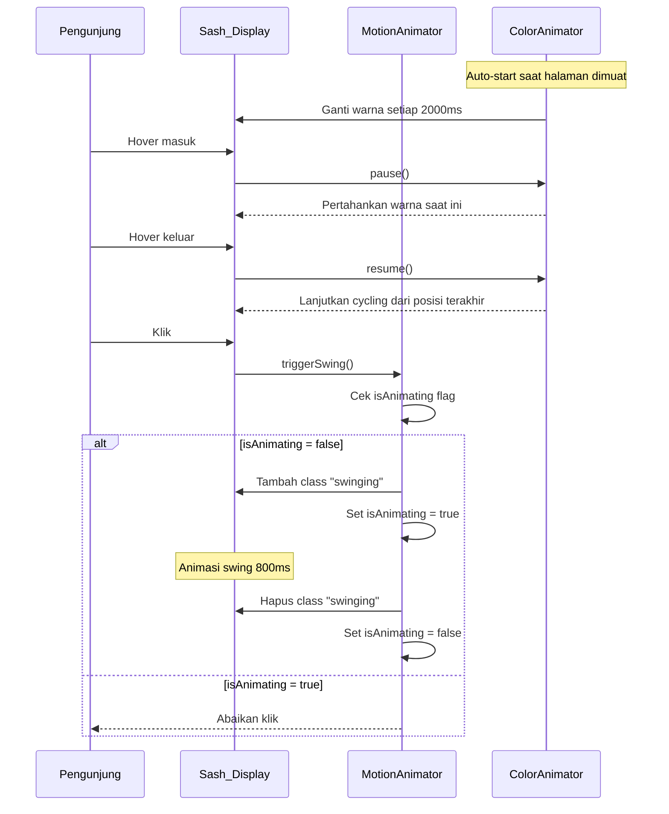

# Design Document

## Overview

Wisuda Sash Store adalah website toko selempang wisuda (graduation sash) berbasis **single-file HTML** yang menggabungkan CSS dan JavaScript secara inline tanpa dependensi eksternal berbayar. Website ini menonjolkan pengalaman visual yang interaktif — pengunjung dapat melihat animasi selempang bergerak (swing) saat diklik dan animasi pergantian warna (color cycling) otomatis — semuanya dalam tema biru dan putih yang elegan.

Arsitektur utama adalah **vanilla HTML/CSS/JS** murni (tidak ada framework) yang dikemas dalam satu file `index.html`. Pendekatan ini dipilih karena:

- **Zero build step** — tidak perlu Node.js, bundler, atau CDN berbayar
- **Portabilitas maksimal** — file tunggal bisa dibuka langsung di browser
- **Performa tinggi** — tidak ada network request untuk library eksternal
- **Sederhana untuk di-deploy** — cukup upload satu file ke hosting statis manapun

---

## Architecture

Website ini mengikuti pola **Single-Page Static Website** dengan pemisahan tanggung jawab logis melalui modul JavaScript IIFE (Immediately Invoked Function Expression) yang diorganisasi dalam satu `<script>` tag.



### Aliran Interaksi Pengguna



---

## Components and Interfaces

### 1. Navigation Component

Komponen header yang fixed di atas halaman.

**Elemen:**
- Logo toko (teks + ikon selempang SVG inline)
- Menu navigasi: Beranda, Produk, Tentang, Kontak
- Tombol CTA "Pesan Sekarang" → smooth scroll ke `#contact`

**Behavior:**
- Pada mobile (< 768px): menu hamburger yang toggle visibility daftar menu
- Sticky/fixed positioning agar selalu terlihat saat scroll

---

### 2. Hero Section Component

Bagian pembuka halaman utama.

**Elemen:**
- Teks judul utama toko
- Deskripsi singkat produk
- `Sash_Display` — elemen visual selempang interaktif (target animasi swing & color cycling)
- Tombol CTA sekunder

**Interface dengan Animator Modules:**
```
SashDisplay {
  element: HTMLElement         // <div id="sash-display">
  currentColor: string         // warna aktif saat ini
  isHovered: boolean           // status hover
}
```

---

### 3. ColorAnimator Module

Modul JavaScript yang mengelola animasi siklus warna otomatis.

**Interface:**
```javascript
ColorAnimator {
  colors: string[]             // array hex warna (#1a237e, #1565c0, ...)
  currentIndex: number         // indeks warna aktif
  intervalId: number | null    // ID dari setInterval
  transitionDuration: number   // 500ms

  init(element): void          // Memulai color cycling pada elemen target
  pause(): void                // Menjeda interval (saat hover)
  resume(): void               // Melanjutkan dari currentIndex terakhir
  setColor(index): void        // Menerapkan warna ke elemen dengan fade transition
  destroy(): void              // Membersihkan interval (cleanup)
}
```

**Warna yang didukung (minimum 5):**
| Index | Nama       | Hex       |
|-------|------------|-----------|
| 0     | Biru Tua   | `#1a237e` |
| 1     | Biru Sedang| `#1565c0` |
| 2     | Biru Muda  | `#42a5f5` |
| 3     | Emas       | `#ffd700` |
| 4     | Merah      | `#c62828` |

**Accessibility:** Saat `prefers-reduced-motion: reduce` terdeteksi, `init()` hanya menerapkan warna pertama tanpa memulai interval.

---

### 4. MotionAnimator Module

Modul JavaScript yang mengelola animasi gerakan swing saat klik.

**Interface:**
```javascript
MotionAnimator {
  isAnimating: boolean         // flag anti-overlap
  duration: number             // 800ms

  init(element): void          // Mendaftarkan event listener klik
  triggerSwing(): void         // Memulai animasi swing
  onAnimationEnd(): void       // Callback cleanup setelah animasi selesai
}
```

**CSS Classes yang Digunakan:**
- `.swinging` — ditambah saat animasi aktif, dihapus setelah selesai

**Accessibility:** Saat `prefers-reduced-motion: reduce` terdeteksi, klik hanya memicu efek visual statis (misalnya brief opacity change) tanpa transform animation.

---

### 5. Product Gallery Component

Grid galeri produk yang responsif.

**Elemen:**
- Minimum 6 `Product_Card`
- Grid CSS: 3 kolom (desktop ≥ 1024px), 2 kolom (tablet 768–1023px), 1 kolom (mobile < 768px)

**Product_Card Structure:**
```
ProductCard {
  image: string       // SVG atau data URI gambar selempang
  name: string        // nama produk
  description: string // maks 100 karakter
  price: string       // harga dalam format Rupiah
  orderButton: HTMLElement  // tombol "Pesan" → smooth scroll ke #contact
}
```

**Hover Effect:** CSS `transition` pada `box-shadow` dan `transform: translateY(-8px)`.

---

### 6. Contact Section Component

Seksi kontak dan pemesanan.

**Elemen:**
- Nomor WhatsApp (ditampilkan + link `wa.me/`)
- Email toko
- Ikon media sosial (Instagram, TikTok) — tautan eksternal
- Tombol "Chat WhatsApp" — membuka `https://wa.me/{nomor}?text={pesan_default}` di tab baru

---

### 7. Footer Component

- Nama toko
- Deskripsi singkat (tagline)
- Teks hak cipta dengan tahun dinamis via `new Date().getFullYear()`

---

## Data Models

Karena ini adalah website statis single-file tanpa backend, "data model" di sini merujuk pada struktur data JavaScript yang digunakan secara runtime.

### ProductData

```javascript
/**
 * @typedef {Object} ProductData
 * @property {string} id          - Identifier unik produk (e.g., "sash-001")
 * @property {string} name        - Nama produk
 * @property {string} description - Deskripsi singkat, maksimal 100 karakter
 * @property {string} price       - Harga, e.g., "Rp 75.000"
 * @property {string} color       - Warna utama produk (hex string)
 * @property {string} imageAlt    - Teks alt untuk aksesibilitas
 */
const PRODUCTS = [
  { id: "sash-001", name: "Selempang Biru Royal",    description: "Selempang wisuda elegan warna biru royal premium", price: "Rp 75.000",  color: "#1a237e", imageAlt: "Selempang wisuda warna biru royal" },
  { id: "sash-002", name: "Selempang Biru Langit",   description: "Selempang wisuda warna biru langit cerah modern",  price: "Rp 70.000",  color: "#42a5f5", imageAlt: "Selempang wisuda warna biru langit" },
  { id: "sash-003", name: "Selempang Emas Prestige", description: "Selempang wisuda warna emas mewah dan berkilau",   price: "Rp 85.000",  color: "#ffd700", imageAlt: "Selempang wisuda warna emas" },
  { id: "sash-004", name: "Selempang Merah Berani",  description: "Selempang wisuda warna merah tegas dan percaya diri", price: "Rp 72.000", color: "#c62828", imageAlt: "Selempang wisuda warna merah" },
  { id: "sash-005", name: "Selempang Biru Navy",     description: "Selempang wisuda warna navy klasik dan formal",   price: "Rp 78.000",  color: "#1565c0", imageAlt: "Selempang wisuda warna biru navy" },
  { id: "sash-006", name: "Selempang Putih Suci",    description: "Selempang wisuda warna putih bersih dan anggun",  price: "Rp 68.000",  color: "#f5f5f5", imageAlt: "Selempang wisuda warna putih" },
];
```

### AnimatorState

```javascript
/**
 * @typedef {Object} ColorAnimatorState
 * @property {string[]} colors           - Array hex warna untuk cycling
 * @property {number}   currentIndex     - Indeks warna aktif saat ini
 * @property {number|null} intervalId    - ID setInterval aktif, null jika paused
 * @property {boolean}  isPaused         - True saat hover (interval dihentikan sementara)
 * @property {number}   cycleDuration    - Durasi per warna: 2000ms
 * @property {number}   transitionDuration - Durasi fade: 500ms
 */

/**
 * @typedef {Object} MotionAnimatorState
 * @property {boolean} isAnimating  - True saat animasi swing sedang berjalan
 * @property {number}  duration     - Durasi animasi: 800ms
 * @property {boolean} reducedMotion - True jika prefers-reduced-motion aktif
 */
```

### CSS Custom Properties (Design Tokens)

```css
:root {
  /* Warna utama */
  --color-primary:      #1565c0;   /* Biru sedang — warna brand utama */
  --color-primary-dark: #1a237e;   /* Biru tua — untuk header/footer */
  --color-primary-light:#42a5f5;   /* Biru muda — aksen */
  --color-accent:       #ffd700;   /* Emas — highlight CTA */
  --color-white:        #ffffff;
  --color-text:         #212121;   /* Teks utama */
  --color-text-light:   #f5f5f5;   /* Teks di atas background gelap */

  /* Tipografi */
  --font-family:        'Segoe UI', system-ui, sans-serif;
  --font-size-base:     16px;
  --font-size-lg:       1.25rem;
  --font-size-xl:       2rem;
  --font-size-xxl:      3rem;

  /* Spacing */
  --spacing-sm:         0.5rem;
  --spacing-md:         1rem;
  --spacing-lg:         2rem;
  --spacing-xl:         4rem;

  /* Animasi */
  --animation-swing:    800ms;
  --animation-color:    500ms;
  --animation-hover:    300ms;
  --cycle-interval:     2000ms;

  /* Layout */
  --container-max:      1200px;
  --border-radius:      8px;
}
```

---

## Correctness Properties

*A property is a characteristic or behavior that should hold true across all valid executions of a system — essentially, a formal statement about what the system should do. Properties serve as the bridge between human-readable specifications and machine-verifiable correctness guarantees.*

### Property 1: Color Cycling Menggunakan Warna yang Valid

*For any* state `ColorAnimatorState`, setiap warna yang diterapkan ke `Sash_Display` oleh `ColorAnimator` SHALL merupakan salah satu warna yang terdaftar dalam array `colors`.

**Validates: Requirements 3.2**

---

### Property 2: Color Index Selalu Dalam Batas Array

*For any* operasi `setColor` atau `resume` pada `ColorAnimator`, nilai `currentIndex` SHALL selalu berada dalam rentang `[0, colors.length - 1]`.

**Validates: Requirements 3.1, 3.5**

---

### Property 3: MotionAnimator Mencegah Tumpang Tindih Animasi

*For any* sequence klik pada `Sash_Display`, jika `isAnimating` bernilai `true`, maka klik tambahan SHALL tidak memulai animasi baru (flag tetap `true` dan tidak ada pemanggilan `triggerSwing` tambahan).

**Validates: Requirements 2.3**

---

### Property 4: Teks Deskripsi Produk Tidak Melebihi Batas Karakter

*For any* `ProductData` dalam array `PRODUCTS`, panjang `description` SHALL tidak melebihi 100 karakter.

**Validates: Requirements 4.2**

---

### Property 5: Hover Pause–Resume Mempertahankan Posisi Warna

*For any* state `ColorAnimator`, ketika hover masuk lalu keluar (`pause()` diikuti `resume()`), `currentIndex` SHALL tetap sama dengan nilai saat `pause()` dipanggil.

**Validates: Requirements 3.4, 3.5**

---

## Error Handling

### Reduced Motion Preference

**Kondisi:** `window.matchMedia('(prefers-reduced-motion: reduce)').matches === true`

**Handling:**
- `ColorAnimator.init()` → hanya panggil `setColor(0)` tanpa memulai `setInterval`
- `MotionAnimator.init()` → daftarkan event listener tapi `triggerSwing()` hanya memicu brief opacity change, bukan transform animation

```javascript
const reducedMotion = window.matchMedia('(prefers-reduced-motion: reduce)').matches;
```

### WhatsApp Link Fallback

**Kondisi:** Nomor WhatsApp tidak terkonfigurasi.

**Handling:** Tombol "Chat WhatsApp" di-disable dengan atribut `aria-disabled="true"` dan menampilkan tooltip "Kontak tidak tersedia".

### Gambar Produk Gagal Dimuat

**Kondisi:** Karena gambar adalah SVG inline / data URI, tidak ada network failure. Namun jika elemen `` digunakan, atribut `alt` yang deskriptif sudah wajib ada (Requirements 6.2) sehingga screen reader tetap memberikan informasi.

### Interval Cleanup

**Kondisi:** Jika halaman di-navigate away (SPA atau bSFP cache).

**Handling:** `ColorAnimator.destroy()` dipanggil pada event `visibilitychange` ketika `document.hidden === true`, lalu di-reinit saat `document.hidden === false`.

```javascript
document.addEventListener('visibilitychange', () => {
  if (document.hidden) {
    colorAnimator.destroy();
  } else {
    colorAnimator.init(sashElement);
  }
});
```

---

## Testing Strategy

### Pendekatan Pengujian

Karena website ini menggunakan **vanilla JavaScript tanpa framework** dan dikemas dalam satu file HTML, strategi pengujian menggunakan:

1. **Unit Tests** — menguji modul-modul JavaScript secara terisolasi menggunakan **Jest** (dapat menguji logika JS tanpa browser)
2. **Property-Based Tests** — memverifikasi properti universal menggunakan **fast-check** (tersedia via CDN untuk browser tests, atau npm untuk Jest)
3. **Integration Tests** — menguji interaksi komponen menggunakan **Playwright** (end-to-end browser testing)

### Unit Tests

Fokus pada kasus spesifik dan edge case:

| Test Case | Target | Tipe |
|-----------|--------|------|
| `ColorAnimator.init()` dengan `prefers-reduced-motion` aktif tidak memulai interval | ColorAnimator | Unit |
| `ColorAnimator.pause()` menghentikan interval | ColorAnimator | Unit |
| `ColorAnimator.resume()` melanjutkan dari `currentIndex` yang sama | ColorAnimator | Unit |
| `MotionAnimator.triggerSwing()` mengatur `isAnimating = true` saat animasi berlangsung | MotionAnimator | Unit |
| `MotionAnimator` mengabaikan klik kedua saat `isAnimating = true` | MotionAnimator | Unit |
| Deskripsi produk tidak melebihi 100 karakter | ProductData | Unit |
| Footer menampilkan tahun yang benar dari `new Date().getFullYear()` | Footer | Unit |

### Property-Based Tests

Menggunakan **fast-check** untuk memverifikasi properti universal (minimum 100 iterasi per properti).

Library: [`fast-check`](https://fast-check.dev/) — pilihan karena API yang ekspresif, dukungan TypeScript, dan aktif dikelola.

Setiap property test direferensikan dengan tag:

```
// Feature: wisuda-sash-store, Property {number}: {property_text}
```

| Property | Implementasi PBT |
|----------|------------------|
| Property 1: Color Cycling Menggunakan Warna Valid | Generate random `currentIndex` operations, verifikasi output selalu dari `colors[]` |
| Property 2: Color Index Selalu Dalam Batas | Generate random sequence operasi cycling, verifikasi `0 <= index < colors.length` |
| Property 3: Anti-Overlap Animation | Generate random click sequences saat `isAnimating = true`, verifikasi tidak ada animasi ganda |
| Property 4: Deskripsi ≤ 100 Karakter | Untuk setiap `ProductData` dalam `PRODUCTS`, verifikasi `description.length <= 100` |
| Property 5: Pause–Resume Preserves Index | Generate random `currentIndex`, pause, resume, verifikasi index tidak berubah |

**Contoh implementasi Property 2:**

```javascript
// Feature: wisuda-sash-store, Property 2: Color index selalu dalam batas array
test('ColorAnimator index selalu dalam batas', () => {
  fc.assert(
    fc.property(
      fc.array(fc.integer({ min: 0, max: 10 }), { minLength: 1, maxLength: 50 }),
      (operations) => {
        const animator = new ColorAnimator(['#1a237e', '#1565c0', '#42a5f5', '#ffd700', '#c62828']);
        operations.forEach(() => animator.advance());
        return animator.currentIndex >= 0 && animator.currentIndex < animator.colors.length;
      }
    ),
    { numRuns: 100 }
  );
});
```

### Integration Tests (Playwright)

Menguji perilaku end-to-end di browser nyata:

| Skenario | Verifikasi |
|----------|------------|
| Color cycling berjalan otomatis | Warna `Sash_Display` berubah setelah > 2000ms |
| Swing animation saat klik | Class `swinging` ditambahkan lalu dihapus setelah 800ms |
| Hover menjeda color cycling | Warna tidak berubah selama kursor di atas elemen |
| Tombol "Pesan" smooth scroll ke `#contact` | `window.scrollY` mendekati offset `#contact` |
| Tombol "Chat WhatsApp" membuka tab baru | Event `popup` terdeteksi pada `page` |
| Responsivitas grid | Viewport mobile menampilkan 1 kolom, desktop 3 kolom |
| Fokus keyboard terlihat | Elemen fokus memiliki `outline` yang visible |
